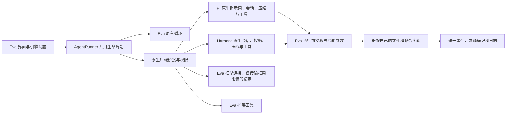

# Eva 多执行引擎实现与验证

> 本文记录 11 月 3 日验证基线；后续原生会话续接、公开事件、展示定义与长任务插件见 [11 月 4 日技术记录](2026-11-04-Eva-Agent宿主实现与验证.md)。

日期：2026-11-03，原生后端接管版本。

## 改造原因和范围

初版的 Pi/Harness 只驱动循环，实际模型上下文和核心工具仍回调 Eva，不能解决 Eva 文件或命令执行实现本身的问题。本次把原生模式分流前移，让框架拥有提示词、运行时上下文、压缩、原生工具定义及执行体。

固定依赖：Pi agent-core / pi-ai / **pi-coding-agent 1.5.0**；DeepSeek Harness 核心、文件工具、文件观察策略、命令后端、附件和压缩包 **0.2.1-rc.5**；Cordis **4.0.5**。版本和完整性固定在 `package-lock.json`。

参考：[Pi 官方仓库](https://github.com/earendil-works/pi)、[Harness 官方仓库](https://github.com/deepseek-ai/deepseek-harness)、[Harness 命令执行接口说明](https://github.com/deepseek-ai/deepseek-harness/tree/master/packages/shell)。实际实现以安装的固定版本代码和类型声明为准。

## 运行链路

### 主进程与协议

`agent-runner.ts` 在构建 Eva 系统提示词和 ContextManager 上下文之前分流到 `native-engine-runner.ts`。原生模式不再调用 Eva 的 `buildContext`、`buildSystemPrompt`、`executeLLMCall` 或核心文件/终端工具。

原生会话生成模型请求，主进程只使用已有 provider 连接发送并流式转发标准数据块；框架侧适配器组装各自的消息格式。API Key 保留主进程。`nativeToolCallsOnly` 禁止 OpenAI 兼容连接使用 Eva 旧式文本工具信封修复；该标记不发给供应商。模型错误回传框架处理，终态仍保留供应商诊断，不在另一引擎上重放任务。

损坏或非对象的工具 JSON 保留原始参数，由框架作为参数错误反馈并继续模型循环；桥接解析不再直接结束整轮，也不补猜参数执行。历史请求通过 `rawArguments` 保留原始字节。集成测试分别验证原生写入和无必填参数的 Eva 扩展都不会因损坏参数被误执行，随后模型能在同一轮修正并完成写入。

JSON 行协议包括模型流、原生工具授权/结果、命令启动计划、文件重检、框架拒绝、扩展工具和完成消息。原生后端初始化有超时；每次真实模型调用，包括原生压缩请求，都计入安全上限。

### Pi

`resources/execution-engines/pi.mjs` 使用真实 Pi Agent、SessionManager、提示词构建器、`read/edit/write/ls` 工具以及 Windows `powershell` / POSIX `bash` 工具。只导入固定 SDK 的运行模块，避免启动 CLI/TUI、自动加载用户插件或读取独立凭据文件。

文件工具通过原生实现读取、格式化、匹配和修改文件。命令仍使用 Pi 原生 shell 执行后端，操作接口只负责在 spawn 前取得 Eva 沙箱参数，不回调 Eva 的 `execute_command`。保留原生 PowerShell 的 UTF-8 初始化，并验证中文输出；未提供的 `PI_*` 会话环境能力不会写进工具指导。

上下文压力触发原生 `prepareCompaction/compact`，将压缩结果写入内存 SessionManager，再替换当前框架请求上下文。压缩提示词也由 Pi 生成，压缩正文不冒充用户答复。

### DeepSeek Harness

`resources/execution-engines/harness.mjs` 装配真实 Session、Projection、SystemPrompt、AgentLoop、`tool-fs`、`fs-local`、`fs-observation-policy`、平台原生命令工具/后端、Subprocess、附件、TokenMeter 和 compaction-basic。

文件工具保留原生 schema，例如 `read.file_path`、`edit.old_string/new_string`；Harness 自己执行读取、版本观察、编辑和结果渲染。受限 LocalFs 子类在解析目标和真正写入/编辑前请求授权重检，具体 I/O、原子发布和过期版本判断仍由原生实现完成。

命令后端继承原生 LocalPwsh/LocalBash，调用原生 `executeArgv` 执行 Eva 已包装的 argv，保留原生超时、输出裁剪和进程管理。当前不提供脱离本轮控制的后台命令。

Harness 使用原生会话投影和压缩。跨轮导入的旧消息明确标为历史参考，因为 Eva 原记录中没有可供恢复的完整 Harness provider stream；本轮实际模型和工具事件由 Harness 正常记入自身会话。

## 授权、事件和取消

`native-tool-policy.ts` 负责能力映射、真实路径/链接检查、目录授予、只读授予、精确可写路径、审批和沙箱。框架工具名保持不变，审批类别通过语义别名映射到 Eva 已有策略。文件元数据读取与真正写入分别检查，避免合法原生写入因内部元数据读取而误被拒绝。

已授权命令的实际 argv 和 cwd 经过沙箱包装，进程仍由 SDK 执行。精确文件范围运行不暴露原生命令能力。Windows 继续采用现有政策检查型沙箱，不声称新增 OS 级隔离。

原生工具的真实开始和结果继续记入统一执行日志，保留引擎、原生来源和操作类型。框架参数拒绝只显示为未执行错误。失败操作签名和操作 ID 不可用来自动重复产生副作用；日志收尾失败不触发重放。

`shared/tool-semantics.ts` 为观察/操作分类、路径参数和展示提供别名，不改写实际工具名。UI 根据真实协议元数据展示「Pi 原生」「Harness 原生」「Eva 扩展」，并识别 `path` 与 `file_path`。选择了 Pi 不意味着所有工具都标为 Pi。

取消通知原生 Agent，取消在途模型/工具；收尾有界等待，必要时结束进程树。Windows 强制清理等待 `taskkill` 收尾，避免刚发起清理就报告停止。测试会等待原生命令写出其真实 PID 后取消，再确认进程已退出，而不仅检查界面停止状态。

## 上下文与扩展边界

Eva 持久化对话并在运行开始时提供历史、用户角色、业务参考和经授权读取的项目根 `AGENTS.md`；不预装 Eva 整套平台/输出风格提示词，也不自动读取 PROJECT_MEMORY。项目规则上限 64 KiB，超限报错，不注入半截规则。

框架运行时持有自己的消息和原始模型响应，包括必要的推理回放内容；这改变了初版「思考不进入 worker」的边界。API Key 仍不进入 worker，私有思考不能作为工具执行证据或额外工程记忆。

图片使用真实编码/附件服务处理，工具输出图片在完整 tool 事务之后作为用户角色图像传给模型，避免 OpenAI 工具消息携带不支持的图片数组。视觉能力仍使用共用模型能力判据，文本模型不会收到图片字节。

网页、MCP、表格、Goal/Team 等能力经明确标识的 Eva 扩展工具调用。文件搜索等未挂载原生等价物的能力继续作为扩展，Harness 目录列举也是扩展；用户可改用原生命令完成搜索和列举。扩展授权不变，返回图片可进入原生会话。

原生模式不再沿用 Eva 循环的缓存、截批、强制回读、完成探针及回复修复策略；使用框架自己的调度和上下文行为。上层 Goal/Team、审批、取消、安全上限与日志保留。原有 Eva 模式保持原逻辑。

## 打包和验证

Electron 33 的内置 Node 不满足要求，框架由外部 Node ≥22.19.0 运行。构建脚本复制全部 runtime 模块和安装依赖闭包到 asar 外 `execution-engines`。独立验证把产物复制到仓库外，使用真实 SDK 完成「读文件 → 编辑 → 原生命令 → 回读 → 回答」，检查实际落盘内容，不能借开发目录依赖通过。

验证结果：55 项真实原生后端集成、6 项独立权限、4 项来源展示检查通过；完整回归 **129 文件 / 1104 项通过**，以 `--maxWorkers=2 --minWorkers=1` 运行。Node/Web 类型检查、受信 IPC 检查、115 项打包规则、生产构建、隔离 Electron 浏览器检查和差异格式检查均通过。构建生成 main/preload/renderer 及包含 217 个已安装包的独立引擎资源；保留既有 streamdown `use client` 指令忽略提示。两后端在仓库外均完成「原生读取 → 编辑 → 原生命令 → 回读验证 → 结束」，实际文件修改和命令落盘结果通过断言。

集成测试把 Eva 核心工具替换为一调用就抛错的函数，验证真实 SDK 仍能改动临时文件和启动命令；覆盖提示词/历史归属、图片输入及原生图片输出、原生压缩、权限和链接越界、审批拒绝、精确写入、在途命令取消、消费者关闭、模型失败、损坏工具参数的同轮恢复、日志和引擎切换。另验证原生模式不使用 Eva 文本工具信封修复、原始错误参数的历史序列化，以及 UI 语义别名。

所有模型响应均为受控输入。尚未调用真实模型账号评估长任务完成率、费用或延迟；只验证本机 Windows / Node 24.22.1。未生成安装包、未提交或推送，保留本轮开始前的未提交工作。默认引擎仍为 Eva，原生会话按运行重建，不提供在途状态互迁、完整 CLI 配置自动加载或跨进程副作用 exactly-once。
