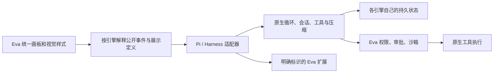

# Eva Agent 宿主实现与验证

日期：2026-11-04。

## 从原生核心到宿主

11 月 3 日版本接管了提示词、上下文压缩和文件/命令实现，但原生会话仍按运行重建，原生流在适配器中被收齐，桌面 IPC 仍套用 Eva 的进度投影。新的实现同时贯通原生会话、事件和展示定义。

Pi 固定为 1.5.0，Harness 固定为 0.2.1-rc.5，Cordis 固定为 4.0.5。没有通过浮动升级追赶官方最新开发版本。参考：[Pi 官方仓库](https://github.com/earendil-works/pi)、[Harness 官方仓库](https://github.com/deepseek-ai/deepseek-harness)；接口核对以安装版本的实现和类型声明为准。

## 原生执行和事件

- `native-engine-runner.ts` 的模型传输异步推进，继续接收 worker 事件；SDK 可以在供应商流结束之前发出公开文字。终态等待所有在途模型统计收尾，避免用量/耗时丢失。
- Pi 将传输数据送入 SDK AssistantMessageEventStream，并转发真实 Agent 的消息边界和工具更新。Harness 将传输增量实时转为原生 StreamChunk，再监听 `agent/assistant-stream` 与双参数 `session/event(session, event)`。
- `NativeAgentEvent` 携带引擎、运行 ID、单调序号、消息/工具关联和公开数据。私有推理不进入公开事件。相邻文字增量只做无损合并，原生 SDK 日志保留自己的帧。
- Harness 工具最终结果取自 `tools/result`，处于校验、策略和内容最终处理之后。展示使用工具自己的 `presentCall` / `presentResult`；展示函数异常不改变执行授权或操作结果。
- 不强制原生工具串行，使用 SDK 默认并发与安全分类。失败操作签名和调用 ID 仍不可用于重放副作用。

Harness 增挂原生 `tool-todo`、`goal`、`goal-round-driver`、`tool-goal`、`llm-retry`、`session-persistence-jsonl` 和 `session-checkpoint-policy`。有相应宿主能力时，原生目标工具替换 Eva 的 `run_goal/manage_goal`，原生待办替换 `create_execution_plan`；这些工具写入原生会话状态，不调用 Eva GoalPlanner。Eva 专属能力仍是插件。

Goal Driver 在原生目标有效时继续同一会话的新回合；重试插件只恢复符合 SDK 策略的模型请求。网络错误映射到 Harness 的 `TRANSPORT` 分类，避免错误分类导致重试插件未生效。原生安全预算独立于 Eva 普通循环设置，默认 1000 次请求、16384 输出 Token，显式子任务预算仍有效；过程显示不影响慢思考开关，宿主不再隐式指定 Eva 默认 temperature。

## 模型思考档位

`shared/model-reasoning.ts` 定义档位、协议类型、能力覆盖及请求投影。模型元数据可覆盖保守的已知 API 推断；`/models` 返回的 effort 列表过滤非法值后保存，未知或显式不支持的连接不显示档位。Anthropic 预算/自适应模式不因 OpenAI 兼容网关背后的模型名字而混用。

旧 `source: probed` 记录实际只探测工具，思考布尔值曾沿用旧推断。新增独立的 `reasoningSource`，菜单及运行能力刷新旧推断，明确的思考不支持声明仍优先；不修改用户凭据或用新探测调用消耗账号。

`ProviderModelOption.reasoningSelection` 保存每个连接与模型的偏好。`config:select-model` 同次写入连接、模型和偏好，主进程校验可用档位；后续编辑连接保留既有偏好。ProviderRegistry 替换未来运行使用的 provider 实例，已有实例仍保持原快照。启动与热更新保留模型的 transport 与思考元数据。

Eva runner 与原生桥接将保存的选择投影到实际请求，不由过程显示设置推导。OpenAI 使用 `reasoning_effort` 和 completion Token 字段，DeepSeek 使用 thinking 开关及 effort，Responses 使用 reasoning.effort，Anthropic 区分自适应 effort 与有输出上界的预算。默认不强制设置，关闭仅在支持时提供。明确参数被网关拒绝后不静默移除；既有未指定 effort 的兼容降级保留。

接口核对：[OpenAI reasoning](https://developers.openai.com/api/docs/guides/reasoning)、[DeepSeek thinking](https://api-docs.deepseek.com/guides/thinking_mode/)、[DeepSeek 模型元数据](https://api-docs.deepseek.com/api/list-models/)、[Anthropic effort](https://platform.claude.com/docs/en/build-with-claude/effort)。测试使用受控模型响应和实际适配器，不调用真实账号评估延迟、费用或所有网关的兼容性。

最终思考档位验证包括 67 项相关单元测试、78 项真实 SDK 集成中的新档位用例、Node/Web 类型检查、IPC/打包规则、三主题窄屏 Electron 菜单/持久恢复/对比度检查和生产构建。完整回归最终 133 文件 / 1173 项通过；执行引擎测试仍运行真实文件与命令，没有替换为模拟执行。

## 完全访问的本地工具授权

按用户后续要求，`full-access` 从仅文件范围扩展为本地会话的「全部磁盘 + 已启用工具免审批」。本地聊天、内嵌任务、Goal/团队和模型讨论把可信的会话快照传入 `createLocalExecutionPolicy`，只在该次运行的审批配置中覆盖为 `off`；子 runner 继承同一回调，不修改保存的全局偏好。旧 `accessScope: full` 兼容该语义，但明确的 `workspace/granted-folders` 优先，切回后恢复原策略。

授权仍经过工具启用清单、沙箱、规划模式只读、精确路径及取消检查；网络和 QQ 入口不传这份本地授权，保留其审批归属。前端使用「完全访问」并解释同时放行工具，设置中的审批说明明确适用于其他权限档位。审批目录始终取宿主请求上下文。

权限改造后，定向 5 文件 / 132 项、类型检查、全量 132 文件 / 1149 项、隔离 Electron 检查及生产构建均通过。真实 Pi/Harness SDK 测试覆盖免审批的文件写入、原生命令和宿主扩展；策略测试覆盖切回恢复、全局偏好不变、子运行继承和规划/取消约束。模型响应仍为受控输入。

## 原生持久状态

`native-session.ts` 以会话 ID、工作目录、引擎和新建代次隔离目录。Pi 使用原生 SessionManager 文件，Harness 使用原生 JSONL 持久服务和 `agents.resume`，附件保存在该代次的持久目录。

宿主游标只记录已提供的用户消息标识，不重建 SDK 日志。第一次原生正式模型请求抵达传输层后才提交“已进入 SDK”的游标；初始化失败不能消耗下一轮的历史。已有原生状态时，渲染后的 Eva 回复不会覆盖原始上下文。跨引擎间隙的新消息作为参考导入，历史改写开启新代次。

会话生命周期服务统一处理删除和消息截断后的原生状态失效，覆盖桌面与使用该服务的其他入口。删除目标是固定根下的哈希目录，并校验绝对父目录；前端布局状态不进入原生日志。未提供跨进程外部副作用 exactly-once。

## 桌面展示

`conversation.ts` 在原生模式保留公开事件和工具完整反馈，绕开 Eva 的进度标签解析、140/280 字摘要及旁白转计划。原生正文不经过 Eva 的 Markdown 源文本归一化。常规 Eva 模式继续使用其原处理链路。

`use-chat-store`、MessageList 和 MessageBubble 保留消息边界；`NativeAgentView` 依据 `native-agent-transcript.ts` 的引擎适配定义显示内容。消息和工具 ID 使用不同命名空间，同一个工具 ID 的多次尝试保留独立结果。原生工具反馈仍可查看，未知展示卡降级为原始反馈。

Harness 的读取、差异和终端卡消费 SDK 展示定义，Goal/待办消费真实状态事件。最后一条答复置于独立答复区域，过程限高滚动。任务区从当前轮或最近回复读取原生状态，不沿用旧 Eva 清单；Eva 扩展任务另行标识并保留其控制入口。侧栏、主题、对齐和文本样式仍使用 Eva 组件框架。

## Windows 原子发布兼容

真实回归发现 SDK 在读取后立即编辑时可能收到 `ReplaceFileW` 1175。该错误对应原文件及替换文件保留原名，区别于可能部分移动的 1176/1177。[Microsoft 接口说明](https://learn.microsoft.com/en-us/windows/win32/api/winbase/nf-winbase-replacefilew)

`windows-fs-compat.mjs` 通过固定 SDK 的文件系统发布接口接入有界重试：只对 1175，且原文件和暂存文件的身份、长度、时间及模式均未改变时，以累计不足一秒的退避重试同一次 `ReplaceFileW(flags=0)`。不重复执行整个编辑动作，不使用忽略 ACL 的标志，不换用 Eva 文件执行器；未知错误、部分发布、文件变化和取消均停止。该处使用固定版本公开的 `internals.replaceFile` 接口，升级 SDK 时必须重新核对。

## 验证

定向验证已覆盖真实 SDK 会话续接、供应商结束前的原生流、同会话 Goal 自动续轮、原生待办、请求重试且已完成写入不重放、工具自己的展示定义、角色注入边界、独立预算、权限和真实取消。独立测试覆盖游标失效、展示顺序、完整旁白、消息/工具 ID 隔离、无损增量合并以及 Windows 只重试未提交的发布。

最终验证结果：

- Node/Web 类型检查通过；最终完整测试 **133 个文件 / 1173 项通过**（`--maxWorkers=1 --minWorkers=1`），未放宽既有超时。
- 隔离 Electron 检查通过，覆盖现有设置/工作台及两种原生引擎、三主题、360/620px 宽度、完整工具输出、独立答复、暗色对比度、最新事件跟随和用户上滑优先；已目视复核截图。
- 受信 IPC、115 项打包文件规则与差异格式检查通过。生产构建通过，包含 **234 个依赖包和 5 个 worker 模块**，保留既有 streamdown 指令忽略提示。
- `node scripts/verify-execution-engines.mjs` 正常退出（exit 0）。运行资源复制到仓库外，用户项目放在独立的临时目录；Pi 和 Harness 各完成 6 次受控模型请求、5 次原生工具调用，并校验真实编辑内容及命令生成文件，不借用开发仓库依赖。

首轮仓库外探测仍复现过 Windows 1175，最初累计 100ms 的退避未覆盖该情况。最终改为累计 910ms 的有界退避，保留文件身份检查并补充取消测试后，重新通过上述完整测试、构建和独立产物探测。没有据此断言临时占用的具体来源，也没有扩大可重试错误范围。

模型响应受控，没有使用用户账号评估真实长任务质量。官方完整 CLI/Web 插件生态、终端 UI、所有附件展示组件和其他操作系统没有被本轮验证替代。保留既有未提交改动，未提交或推送。

剩余 Windows 风险：思考档位的一次并行全量回归仍出现既有原生编辑 1175；2 项定向读改回读及最终独立完整回归通过。发布守卫未放宽，不能将这次复验表述为已根除所有 Windows 间歇性文件发布拒绝。
